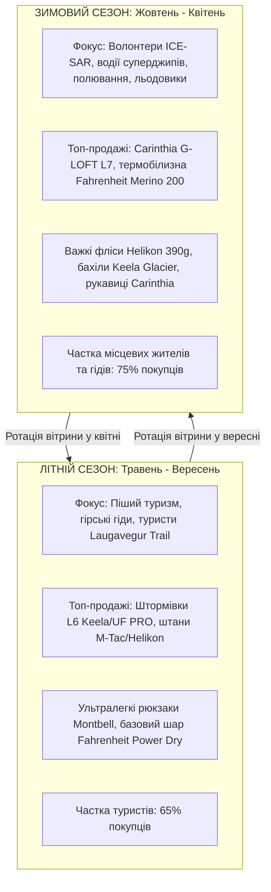

# Стратегія асортиментного наповнення магазину та лідери за категоріями товару: Nordic Tactical & Heavy-Duty Outdoor Hub (Рейк'явік)

**Дата розробки:** Листопад 2026  
**Локація:** Skeifan 108, м. Рейк'явік, Ісландія  
**Площа магазину:** 130 м² (85 м² — торговий зал, 45 м² — склад / бек-офіс e-commerce / B2B)  
**Бюджет першої закупівлі (Initial Inventory):** **€65 000 (~9 750 000 ISK)**  
**Цільова валова маржа (Target Gross Margin):** **55% – 60%**  
**Цільовий мультиплікатор націнки (Markup Multiplier):** **2.3x – 2.5x** (з урахуванням VSK 24%)

---

## 1. Категорійний аналіз ринку: Лідери за 8 ключовими групами товару

Для ісландського клімату традиційні outdoor-класифікації не працюють через специфічний синергетичний ефект екстремальних факторів: штормовий вітер (до 35–40 м/с), висока солоність повітря біля океану, висока відносна вологість при температурах близько 0°C та гострий вулканічний абразив (базальт, лавові поля, курумник).

Нижче наведено детальний аналіз 8 ключових продуктових груп із визначенням лідерів ринку, технологічних переваг та специфіки застосування в Ісландії.

```
                    СТРУКТУРА КАТЕГОРІЙНОГО ПОРТФЕЛЯ
┌──────────────────────────────────────────────────────────────────────┐
│ 1. Штормовий водозахист (Hardshell 3L / L6)                          │
│ 2. Тактичні, робочі та трекінгові штани (Heavy-Duty Pants)           │
│ 3. Софтшели та вітрозахисні куртки (Softshell / Windshirts / L4-L5)  │
│ 4. Базовий натільний термошар (Next-to-Skin Base Layer / L1)         │
│ 5. Середній теплоізолюючий шар та фліси (Mid-Layer Insulation / L2-L3│
│ 6. Екстремальне полярне утеплення (Sub-Zero Extreme Cold / L7)       │
│ 7. Рюкзаки, модульні розвантаження та баули (Load Carriage & Packs)  │
│ 8. Захист кінцівок та аксесуари (Gloves, Gaiters, Headwear, Socks)   │
└──────────────────────────────────────────────────────────────────────┘
```

---

### Категорія 1: Штормовий водозахист (Hardshell 3-Layer / ECWCS L6)

Штормові куртки та овер-штани — головна категорія виживання в Ісландії. Звичайний туристичний дощовик на 5 000–10 000 мм водяного стовпа тут промокає за 30 хвилин через штормовий динамічний тиск вітру.

| Ешелон | Бренд-лідер | Флагманські моделі | Технологічна база | Роздрібна ціна (EUR / ISK) |
| :--- | :--- | :--- | :--- | :--- |
| **Елітний інженерний (High-End)** | **UF PRO** (Словенія) | Monsoon XT Gen.2, Monsoon SmallPac | 3-Layer GORE-TEX / ePTFE 20 000+ мм, Ret < 4.5, плечові демпфери *air/pac®*, капюшон Hood/Harness® | €450 – €680<br>(67 500 – 102 000 ISK) |
| **Рятувальний антиконденсатний** | **Keela Tactical** (Шотландія) | Munro Jacket, Odin Hardshell, Falkland | System Dual Protection (SDP) — подвійна мембрана із захистом від внутрішнього конденсату при +2°C | €220 – €350<br>(33 000 – 52 500 ISK) |
| **Ексклюзивний мануфактурний** | **Tilak MiG** (Чехія) | Raptor MiG, Evolution MiG | GORE-TEX® Pro 3L 28 000 мм, мікрошви 13 мм, блискавки WaterTight | €480 – €750<br>(72 000 – 112 500 ISK) |
| **Технологічний солестійкий** | **Fahrenheit** (Україна) | Gelanots Hard Shell 3L | Безпорова поліуретанова мембрана Gelanots® (Toyota Tsusho) 20k/20k. **Не деградує від морської солі** | €180 – €280<br>(27 000 – 42 000 ISK) |
| **Доступний робочий штормовик** | **M-Tac** (Україна) | Sturm Hardshell, Alpha Pro 3L | Мембранний ламінат 10 000 / 10 000, 100% герметизація швів, посилення Rip-Stop | €95 – €160<br>(14 250 – 24 000 ISK) |

#### Вердикт категорії:
* **Абсолютний лідер інновацій:** **UF PRO Monsoon XT**. Завдяки системі *air/pac* куртка не створює містків холоду під наплічниками, а капюшон рухається разом із головою без перекриття огляду на вітрі.
* **Найкращий вибір для океанічного дощу:** **Keela Munro**. Шотландська система SDP вирішує проблему, від якої страждають усі класичні куртки Gore-Tex в Ісландії — конденсат усередині через 100% вологість повітря.
* **Стійкість до агресивного середовища:** **Fahrenheit Gelanots**. Безпорова структура витримує солоні морські бризки, не забиваючись кристалами NaCl.

---

### Категорія 2: Польові, тактичні та посилені трекінгові штани (Heavy-Duty Pants)

Найбільш високооборотна категорія повсякденного та робочого попиту. В Ісландії штани з тонкого нейлону (20D–40D) миттєво ріжуться об гострі краї лави та базальту.

| Ешелон | Бренд-лідер | Флагманські моделі | Технологічна база | Роздрібна ціна (EUR / ISK) |
| :--- | :--- | :--- | :--- | :--- |
| **Масовий бестселер (Cash Cow)** | **M-Tac** (Україна) | Aggressor Gen.II Flex, Conquistador Flex, Sahara | Тканина NYCO Extreme (Brookwood, USA: 57% Nylon Cordura / 43% Cotton), Teflon® Shield+, фурнітура YKK | €50 – €95<br>(7 500 – 14 250 ISK) |
| **Європейський outdoor-хіт** | **Helikon-Tex** (Польща) | OTP (Outdoor Tactical Pants), UTP, Blizzard | Еластичний софтшел VersaStretch®, StormStretch®, посилені кишені під смартфон та ніж | €65 – €110<br>(9 750 – 16 500 ISK) |
| **Елітний анатомічний стандарт** | **UF PRO** (Словенія) | Striker X Gen.2, Striker ULT, P-40 All-Terrain | Schoeller®-dynamic, Cordura® 500D, 3-рівневий модуль захисту колін з демпферами D3O® | €220 – €380<br>(33 000 – 57 000 ISK) |
| **Еталон Mil-Spec для профі** | **Crye Precision** (США) | G3 Combat Pant, G4 Field Pant | 50/50 NYCO Ripstop, вставки з еластичного твілу, патентовані шарнірні наколінники AirFlex | €280 – €450<br>(42 000 – 67 500 ISK) |
| **Комерційний стандарт США** | **5.11 Tactical** (США) | Stryke Pant, Apex Pant | Механічний стрейч Flex-Tac® Ripstop, грязевідштовхувальне просочення Teflon®, 12 кишень | €85 – €130<br>(12 750 – 19 500 ISK) |

#### Вердикт категорії:
* **Абсолютний лідер щоденного товарообігу:** **M-Tac Aggressor Gen.II Flex**. Поєднання міцності Cordura-нейлону, зручного еластичного пояса та ціни у **€75–€85 (11 000 – 13 000 ISK)** робить ці штани безконкурентними. У магазинах 66°North аналогічні за міцністю штани коштують від 35 000 до 55 000 ISK.
* **Професійний альпійський вибір:** **UF PRO Striker X**. Неперевершена артикуляція суглобів для рятувальників та гідів льодовикових сходжень.

---

### Категорія 3: Софтшели та вітрозахисний шар (Softshell / Windshirts / ECWCS L4-L5)

Універсальний шар для 70% часу активності в Ісландії, коли немає зливи, але дме шквальний холодний вітер 15–25 м/с.

| Ешелон | Бренд-лідер | Флагманські моделі | Технологічна база | Роздрібна ціна (EUR / ISK) |
| :--- | :--- | :--- | :--- | :--- |
| **Міський Low-Profile лідер** | **Pentagon** (Греція) | Artaxes Softshell, Reiner 2.0 | Кліматична мембрана Storm|Tex™ (8 000 / 5 000), вафельний мікрофліс Grid-Tech, блискавки Quick-Free™ | €110 – €160<br>(16 500 – 24 000 ISK) |
| **Польовий тактичний софтшел** | **M-Tac** (Україна) | Soft Shell Police, Commander, Falcon | 3-шаровий мембранний Softshell на флісі, стійкість до вітру 100%, брудовідштовхувальне просочення | €75 – €125<br>(11 250 – 18 750 ISK) |
| **Ультралегкий вітрозахист (L4)** | **Helikon-Tex** (Польща) | Trooper Softshell, Gunfighter, Windrunner | Тканина StormStretch® з обробкою Teflon, підпахова вентиляція, прихований у комір капюшон | €80 – €140<br>(12 000 – 21 000 ISK) |
| **Преміальний гірський стрейч** | **Carinthia** (Австрія) | Loftshell Climate Jacket, G-LOFT ISG 2.0 | Гібрид софтшелу та утеплювача G-LOFT®, мембрана Gore Windstopper® 3L | €240 – €360<br>(36 000 – 54 000 ISK) |

#### Вердикт категорії:
* **Найпопулярніший вибір для міста та легких трекінгів:** **Pentagon Artaxes**. Куртка має стриманий спортивний вигляд без надлишкової мілітаризації, зігріває вафельним мікрофлісом і відсікає вітер.
* **Гібридний функціонал:** **Carinthia ISG 2.0 (Insulated Softshell Garment)** — унікальна модель із зональним утепленням G-LOFT на тулубі та еластичними рукавами софтшел для повної свободи рухів.

---

### Категорія 4: Базовий натільний термошар (Next-to-Skin Base Layer / ECWCS L1)

Фундамент виживання. Головне правило ісландського outdoor: **"Cotton kills" (бавовна вбиває)**. Тільки гідрофобна синтетика або високогірна вовна мериноса.

| Ешелон | Бренд-лідер | Флагманські моделі | Технологічна база | Роздрібна ціна (EUR / ISK) |
| :--- | :--- | :--- | :--- | :--- |
| **Технологічний лідер Polartec** | **Fahrenheit** (Україна) | Base Layer Polartec® Power Dry®, Power Wool® | Ліцензійний Polartec® двокомпонентної структури (внутрішній шар миттєво вбирає піт, зовнішній випаровує) | €55 – €95<br>(8 250 – 14 250 ISK) |
| **Преміальна натуральна вовна** | **Fahrenheit** (Україна) | 100% Merino Wool 200 g/m² | Тонкорунна австралійська мериносова вовна (18.5 мікрон). Зберігає тепло мокрою, не накопичує бактеріальний запах | €70 – €120<br>(10 500 – 18 000 ISK) |
| **Гірський ультралайт** | **KUIU** (США) | ULTRA Merino 120 / 145 | Вовна мериноса за технологією Nuyarn® (намотування волокон на нейлонову серцевину — у 5 разів міцніша за звичайну вовну) | €90 – €145<br>(13 500 – 21 750 ISK) |
| **Японський всесезонний базовий** | **Montbell** (Японія) | Super Merino Wool, GeoLine L.W. | Волокна GeoLine мікрофіламентної крутки з антибактеріальним срібним просоченням | €45 – €85<br>(6 750 – 12 750 ISK) |
| **Доступний тактичний комплект** | **M-Tac** (Україна) | ThermoLine, Level 1 ECWCS | 100% поліестер із зональною компресійною в'язкою, пласкі шви | €25 – €45<br>(3 750 – 6 750 ISK) |

#### Вердикт категорії:
* **Безумовний фаворит асортименту:** **Fahrenheit (Polartec Power Dry та Merino Wool)**. Бренд пропонує бездоганну якість оригінального американського Polartec за ціною майже вдвічі нижчою, ніж термобілизна Icebreaker чи Devold в ісландських супермаркетах.
* **Для багатоденних трекінгів (Laugavegur Trail):** Вовна мериноса **Fahrenheit Merino 200** незамінна, оскільки її можна носити 5–7 днів без виникнення запаху.

---

### Категорія 5: Середній ізолюючий шар та фліси (Mid-Layer Insulation / ECWCS L2-L3)

Створює повітряний прошарок для збереження тепла та відводить випаровування від натільного шару далі до мембрани.

| Ешелон | Бренд-лідер | Флагманські моделі | Технологічна база | Роздрібна ціна (EUR / ISK) |
| :--- | :--- | :--- | :--- | :--- |
| **Еталонний капілярний L2** | **Fahrenheit** (Україна) | Classic Micro Grid, High Loft Jacket | Polartec® Power Grid® (вафельні канали для вентиляції), Polartec® Thermal Pro® High Loft | €75 – €150<br>(11 250 – 22 500 ISK) |
| **Важкий патрульний фліс L3** | **Helikon-Tex** (Польща) | Patriot Heavy Fleece (390 g/m²), Liberty | Надщільний фліс Double Superfine Fleece 390 г/м², посилення Cordura на плечах та ліктях, кишені на спині | €75 – €110<br>(11 250 – 16 500 ISK) |
| **Культовий експедиційний фліс** | **Triple Aught Design** (США) | Ranger Hoodie, Praetorian Hoodie | Polartec® Wind Pro® (у 4 рази щільніший опір вітру), фірмовий капюшон Aero Hood | €280 – €380<br>(42 000 – 57 000 ISK) |
| **Доступний тактичний фліс** | **M-Tac** (Україна) | Delta Fleece, Alpha Microfleece | Фліс щільністю 190–260 г/м², анатомічний крій, блискавки YKK | €25 – €55<br>(3 750 – 8 250 ISK) |

#### Вердикт категорії:
* **Найкраще співвідношення тепла до ваги:** **Fahrenheit High Loft**. Довговорсистий фліс Polartec Thermal Pro створює максимальний об'єм затриманого повітря при мінімальній вазі у рюкзаку.
* **Найкращий "робочий" фліс для рятувальників та водіїв:** **Helikon-Tex Patriot 390g**. Надважкий фліс, який можна носити як верхній одяг у прохолодну суху погоду завдяки посиленням на ліктях і плечах.

---

### Категорія 6: Екстремальне полярне утеплення та парки (Sub-Zero Extreme Cold / ECWCS L7)

Одяг статичного тепла. Використовується рятувальниками ICE-SAR під час нічних пошуків у хуртовину, водіями на стоянках у нагір'ї та фотографами полярного сяйва.

| Ешелон | Бренд-лідер | Флагманські моделі | Технологічна база | Роздрібна ціна (EUR / ISK) |
| :--- | :--- | :--- | :--- | :--- |
| **Абсолютний світовий №1** | **Carinthia** (Австрія) | HIG 4.0 Jacket, ECIG 4.0, MIG 4.0 | Патентований бікомпонентний утеплювач G-LOFT®, Gore Windstopper®, посилення Cordura®. Комфорт до -20°C (HIG) та -30°C (ECIG) | €350 – €750<br>(52 500 – 112 500 ISK) |
| **Вологозахищений японський пух** | **Nanga** (Японія) | Aurora Down Jacket, Takibi Down | Мембранна тканина AURORA-TEX® (20 000 мм), преміальний пух 760–860 Fill Power, вогнетривкий арамід | €380 – €720<br>(57 000 – 108 000 ISK) |
| **Арктичний комплект Level 7** | **A.T.A.K.A.** (Україна) | Костюм Level 7 Subzero | Силіконізована гідрофобна тканина Milliken® EPIC (USA), утеплювач G-Loft 200 г/м² | €220 – €380<br>(33 000 – 57 000 ISK) |
| **Полярна система уряду США** | **Beyond Clothing** (США) | Axios A7 Cold Jacket | Тканина 70D DWR Nylon, утеплювач Climashield® APEX, великі внутрішні кишені для сушіння рукавиць | €380 – €650<br>(57 000 – 97 500 ISK) |
| **Доступна міська зимова парка** | **M-Tac** (Україна) | Alpha Gen.IV, Winter Parka | Утеплювач G-Loft, мембрана 10 000 / 10 000, вставки Cordura 300D, флісові кишені | €140 – €220<br>(21 000 – 33 000 ISK) |

#### Вердикт категорії:
* **Беззаперечний король категорії:** **Carinthia HIG 4.0 та ECIG 4.0**. Це золотий стандарт гірських рятувальників та армій країн Скандинавії. Не боїться мокрого ісландського снігу з дощем, відновлює об'єм після стискання в компресійному мішку.
* **Японська преміальна альтернатива:** **Nanga Aurora Down**. Розв'язує головну ваду пуховиків — мембрана Aurora-Tex надійно захищає пух від промокання.

---

### Категорія 7: Рюкзаки, модульні розвантаження та баули (Load Carriage & Packs)

Спорядження для перенесення вантажів в умовах бездоріжжя та тривалих автономних операцій.

| Ешелон | Бренд-лідер | Флагманські моделі | Технологічна база | Роздрібна ціна (EUR / ISK) |
| :--- | :--- | :--- | :--- | :--- |
| **Німецький стандарт для SAR та медиків** | **Tasmanian Tiger** (Німеччина) | First Responder Move On, Raid Pack MK III, Modular Pack 30 | CORDURA® 700 den, анатомічна спинка V2 Plus System, лазерні слоти MOLLE, органайзери для шин і турнікетів | €160 – €420<br>(24 000 – 63 000 ISK) |
| **Преміальний тактичний лазеркат** | **Direct Action** (Польща) | Dragon Egg MK II (25L), Ghost MK II (30L), Halifax | Ламінат Cordura® 500D з лазерною перфорацією, піна Combat Vent System® для циркуляції повітря на спині | €140 – €260<br>(21 000 – 39 000 ISK) |
| **Масовий надійний комерційний** | **5.11 Tactical** (США) | RUSH12 / RUSH24 / RUSH72 2.0 | Непромокальний нейлон 1050D, відділення CCW, блискавки YKK з паракордовими пулерами | €110 – €250<br>(16 500 – 37 500 ISK) |
| **Ультралегкі туристичні штурмовики** | **Montbell** (Японія) | Versalite Pack 30L / 40L | Тканина Ballistic Ripstop 30D, герметичні рулонні застібки Roll-top, вага всього 600 грамів | €120 – €220<br>(18 000 – 33 000 ISK) |
| **Модульні військові рюкзаки** | **UTactic** (Україна) | Raid Pack 45L, Complex Pack | Cordura® 500D, італійська фурнітура 2M, знімний поясний ремінь | €110 – €210<br>(16 500 – 31 500 ISK) |

#### Вердикт категорії:
* **Для рятувальників ICE-SAR:** **Tasmanian Tiger Modular Pack та First Responder**. Найкраща у світі організація внутрішнього простору під медикаменти, рації та альпіністські карабіни.
* **Для щоденного міського носіння та одноденних трекінгів:** **Direct Action Dragon Egg (25L)**. Компактний, водостійкий, зі зручною спинкою, що вентилюється.

---

### Категорія 8: Захист кінцівок та польові аксесуари (Hands, Feet, Gaiters & Socks)

В Ісландії 80% випадків переохолодження починаються з мокрих ніг або замерзлих пальців рук при сильному вітрі.

| Ешелон | Бренд-лідер | Флагманські моделі | Технологічна база | Роздрібна ціна (EUR / ISK) |
| :--- | :--- | :--- | :--- | :--- |
| **Екстремальні штормові бахіли (Gaiters)** | **Keela** (Шотландія) | Glacier Gaiters, Alpine SDP | Cordura® 1000D на внутрішній щиколотці (захист від кішок і гострого каміння), мембрана SDP | €45 – €85<br>(6 750 – 12 750 ISK) |
| **Трекінгові шкарпетки з мериносу** | **Fahrenheit** (Україна) | Merino Trekking Heavy, Wool Pro | 75% шерсть австралійського мериноса, посилена п'ятка та мисок нейлоном Cordura, еластична підтримка склепіння | €16 – €32<br>(2 400 – 4 800 ISK) |
| **Тактичні рукавиці з утепленням** | **Carinthia** (Австрія) | G-LOFT Ultra Gloves, TIG | Тонкий, але надзвичайно теплий G-LOFT®, вітрозахисний софтшел, шкіряна долоня, тачскрін-пальці | €65 – €120<br>(9 750 – 18 000 ISK) |
| **Механічні захисні рукавиці** | **M-Tac** (Україна) | Assault Tactical, Winter Fleece Gloves | Синтетична замша, формовані захисні демпфери на кісточках, флісова підкладка | €18 – €45<br>(2 700 – 6 750 ISK) |
| **Польові головні убори та бафи** | **Fahrenheit / M-Tac** | Polartec Classic Beanie, Windblock Watch Cap | Оригінальний фліс Polartec® або вітрозахисна мембрана Windblock | €12 – €25<br>(1 800 – 3 750 ISK) |

---

## 2. Комплексна стратегія наповнення магазину (Assortment Matrix)

### 2.1. Розподіл стартового бюджету закупівлі (€65 000 / ~9 750 000 ISK)

Для роздрібного магазину площею 130 м² у комерційному кластері Skeifan рекомендовано наступний початковий поділ інвестицій за 8 категоріями:

```
                            БЮДЖЕТНИЙ РОЗПОДІЛ (€65 000)
┌───────────────────────────────────────────────────────────┬──────────┬───────────┐
│ КАТЕГОРІЯ ТОВАРУ                                          │ ЧАСТКА % │ СУМА В €  │
├───────────────────────────────────────────────────────────┼──────────┼───────────┤
│ 1. Штормовий водозахист L6 (UF PRO, Keela, Fahrenheit)    │   22%    │ €14 300   │
│ 2. Польові та трекінгові штани (M-Tac, Helikon, UF PRO)   │   25%    │ €16 250   │
│ 3. Софтшели та вітрозахист L4-L5 (Pentagon, M-Tac, Helikon│   14%    │ €9 100    │
│ 4. Базовий натільний термошар L1 (Fahrenheit Polartec/Wool│   12%    │ €7 800    │
│ 5. Середній шар та фліси L2-L3 (Fahrenheit, Helikon 390g) │   10%    │ €6 500    │
│ 6. Екстремальне полярне утеплення L7 (Carinthia G-LOFT)   │    9%    │ €5 850    │
│ 7. Рюкзаки та підсумки (Tasmanian Tiger, Direct Action)   │    5%    │ €3 250    │
│ 8. Шкарпетки, рукавиці, бахіли, аксесуари                 │    3%    │ €1 950    │
├───────────────────────────────────────────────────────────┼──────────┼───────────┤
│ РАЗОМ ПЕРША ЗАКУПІВЛЯ:                                    │   100%   │ €65 000   │
└───────────────────────────────────────────────────────────┴──────────┴───────────┘
```

### 2.2. Розмірна сітка з урахуванням антропометрії Ісландії

Ісландці — одна з найвищих націй у світі (середній зріст чоловіків становить 181 см, значний відсоток — 188–195 см із міцною статурою). Стандартні європейські або азійські розмірні сітки призведуть до надлишку розмірів S/M та дефіциту L/XL/XXL з подовженою ростовкою (Long/Tall).

| Розмір | Частка в закупівлі | Специфіка для ісландського ринку |
| :--- | :--- | :--- |
| **S** | **5%** | Мінімальний обсяг (здебільшого для жінок та підлітків). |
| **M** | **20%** | Стандартний розмір для струнких туристів та частини місцевих. |
| **L** | **35%** | **Головний базовий розмір** для більшості чоловічого населення. |
| **XL** | **25%** | **Критично важливий розмір**. Високий попит серед місцевих чоловіків. |
| **XXL** | **12%** | Обов'язкова наявність у всіх лінійках штанів M-Tac та курток Carinthia. |
| **3XL / Long** | **3%** | Нішевий, але дуже лояльний сегмент (штани з маркуванням Long / подовжена штанина). |

---

## 3. Сезонна ротація асортименту (Seasonal Merchandising Cycle)

Кліматичний рік в Ісландії чітко ділиться на два комерційні сезони з кардинально різною структурою чека:



### Літній сезон (Травень – Вересень):
* Відкриття високогірних доріг F-roads (Highlands).
* Головний потік піших туристів та комерційних груп на маршрутах Laugavegur, Landmannalaugar, Thórsmörk.
* **Вітрина магазину:** Штормовий водозахист (Keela SDP, UF PRO Monsoon), легкі дихаючі штани (Helikon OTP, M-Tac Sahara), термобілизна Polartec Power Dry, ультралегкі дощовики Montbell Versalite (134 г).

### Зимовий сезон (Жовтень – Квітень):
* Полярна ніч, сильні хуртовини, температура від 0°C до -15°C при вітрі до 30 м/с (wind chill відчувається як -25°C...-30°C).
* Активні виїзди пошуково-рятувальних загонів ICE-SAR, тури за північним сяйвом, льодолазіння.
* **Вітрина магазину:** Парки Carinthia HIG 4.0 та ECIG, вовняна термобілизна Fahrenheit Merino 200 г/м², важкі фліси Helikon Patriot 390g, штормові утеплені рукавиці та бахіли від снігу.

---

## 4. Логістичний ланцюг поставок та управління вендорами (Vendor Management)

Для уникнення дефіциту товарів у пікові місяці та мінімізації вартості доставки розроблено багаторівневу логістичну схему:

```
┌────────────────────────────────────────────────────────────────────────┐
│ СХЕМА ЛОГІСТИЧНОГО ПОПОВНЕННЯ СКЛАДУ У РЕЙК'ЯВІКУ                     │
├────────────────────────────────────────────────────────────────────────┤
│ 1. БАЗОВІ ПЛАНОВІ ПОСТАВКИ (МОРСЬКИЙ ФРАХТ EIMSKIP / SAMSKIP):         │
│    • Періодичність: 1 раз на 6–8 тижнів.                               │
│    • Об'єм: 2–4 європалети збірним вантажем (LCL) через Роттердам.    │
│    • Вартість доставки: €280 – €380 за палету.                         │
│    • Категорії: Важкі штани M-Tac, фліси Helikon, взуття, рюкзаки.     │
├────────────────────────────────────────────────────────────────────────┤
│ 2. ОПЕРАТИВНИЙ ЕКСПРЕС-ДОЗАКАЗ (ICELANDAIR CARGO АВІАФРАХТ):          │
│    • Періодичність: 1 раз на 2–3 тижні у піковий сезон.               │
│    • Термін: 24–48 годин зі складу в Європі до Кеflavík (KEF).         │
│    • Вартість: €4.00 – €5.50 за кг.                                    │
│    • Категорії: Високомаржинальні дорогі куртки UF PRO, Carinthia,     │
│      термобілизна Fahrenheit дефіцитних ходових розмірів (L, XL).      │
└────────────────────────────────────────────────────────────────────────┘
```

### Умови співпраці з виробниками (B2B Terms):
1. **M-Tac та Fahrenheit (Україна):** Прямі дистриб'юторські договори з фабриками. Пільговий безмитний режим (EFTA-Ukraine). Маржинальність 58–62%, мінімальне замовлення (MOQ) від €3 000.
2. **UF PRO (Словенія) та Carinthia (Австрія):** Прямі контракти офіційного дилера в Ісландії. Фіксована рекомендована роздрібна ціна (RRP/MSRP) з дилерською знижкою 40–48%. Захист території від демпінгу.
3. **Helikon-Tex (Польща) та Pentagon (Греція):** Замовлення через центральні B2B-портали з відвантаженням зі складів у ЄС (Польща/Греція). Швидка консолідація на хабі Eimskip у Роттердамі.
4. **Keela (Шотландія):** Прямий імпорт із Великої Британії (пряме морське сполучення через порт Іммінґем або авіасполучення з Глазго/Единбурга).

---

## 5. Планування та візуальний мерчандайзинг (Zoning 130 m² у Skeifan)

Приміщення в районі Skeifan площею 130 м² організовується за принципом **"Destination Experience Hub"** (магазин-експерт, куди приїжджають цілеспрямовано):

```
┌───────────────────────────────────────────────────────────────────────┐
│              ПЛАНУВАННЯ ТОРГОВОГО ЗАЛУ (SKEIFAN 108)                  │
├─────────────────────────┬─────────────────────────────────────────────┤
│ ЗОНА А: STORM LAB       │ Флагманська зона штормового захисту L6      │
│ (Вхідна група праворуч) │ (UF PRO Monsoon, Keela SDP, Tilak Raptor).  │
│                         │ Стенд тестування мембран під водою.         │
├─────────────────────────┼─────────────────────────────────────────────┤
│ ЗОНА B: PANTS WALL      │ Велика вертикальна стіна тактичних та       │
│ (Центральна стіна)      │ трекінгових штанів M-Tac Aggressor, Helikon │
│                         │ OTP, 5.11 Stryke. Чітка розмірна навігація. │
├─────────────────────────┼─────────────────────────────────────────────┤
│ ЗОНА C: LAYERING BAR    │ "Наукова лабораторія пошарового одягу":     │
│ (Ліве крило)            │ Стенди Polartec Power Grid, вовни мериноса  │
│                         │ Fahrenheit, навчальні постери ECWCS L1–L3.  │
├─────────────────────────┼─────────────────────────────────────────────┤
│ ЗОНА D: SUB-ZERO CORNER │ Зона екстремального арктичного захисту:     │
│ (Глибина залу)          │ Парки Carinthia G-LOFT, пуховики Nanga,     │
│                         │ спальні системи виживання для рятувальників.│
├─────────────────────────┼─────────────────────────────────────────────┤
│ ЗОНА E: GEAR & ACCESSORY│ Рюкзаки Tasmanian Tiger, аптечки IFAK,      │
│ (Біля касової зони)     │ шкарпетки з мериносу, бахіли, рукавиці,     │
│                         │ паракорд, ножі та засоби догляду за взуттям.│
├─────────────────────────┴─────────────────────────────────────────────┤
│ СКЛАД ТА E-COMMERCE HUB (45 м²): Зона пакування посилок для Dropp,     │
│ стелажі швидкого відбору товарів, B2B-стіл переговорів з гідами ICE-SAR│
└───────────────────────────────────────────────────────────────────────┘
```

---

## 6. Стратегічне резюме: Чому ця матриця переможе місцевих конкурентів

1. **Руйнування цінової монополії 66°North:**
   * У 66°North міська парка з тонким нейлоном коштує **130 000 – 190 000 ISK (€850 – €1 250)**.
   * У вашому магазині повний бойовий полярний комплект (куртка **Carinthia HIG 4.0 G-LOFT** + штани **M-Tac NYCO** + білизна **Fahrenheit Polartec**) обійдеться клієнту в **~85 000 ISK (€560)**, маючи при цьому сертифікацію за стандартами армій НАТО.
2. **Перевага над традиційними магазинами Fjallakofinn та Útilíf:**
   * Fjallakofinn фокусується на класичному цивільному альпінізмі (Arc'teryx, Patagonia, Scarpa), де пріоритетом є мінімальна вага, але тканина 20D–30D швидко рветься об лавові скелі.
   * Ваш магазин пропонує категорію **Heavy-Duty Tactical Utility** (Cordura 500D, посилені коліна, анатомічні кишені під рації та ножі), яка ідеально відповідає щоденній важкій роботі ісландських фермерів, рятувальників, водіїв модифікованих позашляховиків та професійних гідів.
