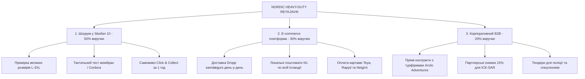

# Монохромна цивільна концепція, ресерч комерційної нерухомості та гібридна бізнес-модель: Nordic Heavy-Duty Hub

**Дата розробки:** Листопад 2026  
**Проєкт:** Відкриття флагманського магазину та інтернет-магазину в Рейк'явіку  
**Концептуальна зміна:** **100% Solid Monochromatic (Повна відмова від мілітарі-камуфляжів, камуфляжних малюнків MultiCam, піксель тощо на користь цивільного преміального Techwear / Heavy-Duty Outdoor у стриманих однотонних кольорах).**

---

## 1. Стратегічне обґрунтування монохромної цивільної концепції

### 1.1. Соціокультурний контекст Ісландії
Ісландія — унікальна держава Європи:
* В країні **немає регулярної армії** (демілітаризоване суспільство).
* Населення ставиться насторожено або скептично до мілітаризованого вигляду (камуфляжні штани чи куртки в місті сприймаються як «воєнізовані» або чужорідні).
* Водночас ісландці мають **величезний культ практичності, зносостійкості та функціональності** через суворий клімат (дощ, вітер 35 м/с, базальтовий пил, мокрий сніг).

### 1.2. Нове позиціонування: Heavy-Duty Techwear & Expeditionary Outdoor
Замість «тактичного магазину/військторгу» ми позиціонуємо бренд як **«Центр надміцного професійного спорядження та одягу для екстремального клімату»**:
* Використовуються ті самі безкомпромісні матеріали: **Cordura® 500D/1000D, G-LOFT®, Polartec® Power Dry/Thermal Pro, GORE-TEX® 3L, мембрани Gelanots® та Toray Dermizax®**.
* Але вся лінійка представлена **виключно в шляхетних однотонних кольорах**:

```
                       КОЛІРНА ПАЛІТРА МАГАЗИНУ (SOLID COLORS ONLY)
┌──────────────────────┬──────────┬─────────────────────────────────────────────────┐
│ КОЛІР                │ ЧАСТКА % │ СФЕРА ЗАСТОСУВАННЯ ТА СПРИЙНЯТТЯ КЛІЄНТОМ       │
├──────────────────────┼──────────┼─────────────────────────────────────────────────┤
│ 1. Solid Black       │   40%    │ Класичний міський Techwear. Універсальний для    │
│    (Глибокий чорний) │          │ ресторанів Рейк'явіка, офісу, авто та трекінгу. │
├──────────────────────┼──────────┼─────────────────────────────────────────────────┤
│ 2. Ranger Green /    │   25%    │ Природний колір ісландського моху та ландшафту. │
│    Dark Olive        │          │ Головний вибір гідів AIMG та любителів природи. │
├──────────────────────┼──────────┼─────────────────────────────────────────────────┤
│ 3. Coyote Brown /    │   15%    │ Теплий пісочно-глиняний відтінок лавових полів. │
│    Canyon / Tan      │          │ Відмінно поєднується з повсякденним джинсом.    │
├──────────────────────┼──────────┼─────────────────────────────────────────────────┤
│ 4. Wolf Grey /       │   12%    │ Сучасний урбаністичний хай-тек стиль. Дуже      │
│    Shadow Grey       │          │ популярний серед архітекторів, IT та туристів.  │
├──────────────────────┼──────────┼─────────────────────────────────────────────────┤
│ 5. Dark Navy         │    8%    │ Традиційний морський темно-синій колір для      │
│    (Північний флот)  │          │ патрульних, водіїв та морських гідів.           │
└──────────────────────┴──────────┴─────────────────────────────────────────────────┘
```

**Результат розвороту:**  
Цільова аудиторія розширюється в **5–7 разів**! Тепер наші штани купують не лише специфічні любителі мілітарі, а й:
* Звичайні мешканці Рейк'явіка, яким набридло щороку рвати тонкі туристичні штани;
* Працівники портів, будівельники, геодезисти, водії експедиційних позашляховиків;
* Туристи, які хочуть виглядати стильно в місті й водночас бути на 100% захищеними на льодовику;
* Волонтери рятувальної служби ICE-SAR (Landsbjörg), які віддають перевагу однотонному спорядженню чорного, оливкового чи темно-синього кольору.

---

## 2. Аналіз ринку комерційної нерухомості в Рейк'явіку

На основі аналізу пропозицій провідних комерційних агентств Ісландії (*Atvinnueign*, *Jöfur Fasteignasala*, *mbl.is fasteignir*) виділено три ключові локації для розміщення комерційного хабу:

```
┌────────────────────────────────────────────────────────────────────────┐
│             ПОРІВНЯЛЬНИЙ АНАЛІЗ ЛОКАЦІЙ У РЕЙК'ЯВІКУ                   │
├───────────────────┬──────────────────┬──────────────────┬──────────────┤
│ КРИТЕРІЙ          │ SKEIFAN (108)    │ GRANDI (101)     │ KÓPAVOGUR    │
│                   │ (РЕКОМЕНДОВАНО)  │ (ПОРТОВИЙ ХАБ)   │ (ДАЛЬВЕГУР)  │
├───────────────────┼──────────────────┼──────────────────┼──────────────┤
│ Орендна ставка/м² │ 2 800 – 3 400 ISK│ 3 200 – 4 200 ISK│ 2 300 – 2 900│
│ Сума оренди 130 м²│ 364k – 442k ISK  │ 416k – 546k ISK  │ 299k – 377k  │
│ (у євро / місяць) │ €2 420 – €2 950  │ €2 770 – €3 640  │ €1 990 – €2 5│
│ Наявність парковки│ Велика безкоштов.│ Обмежена / платна│ Велика       │
│ Сусідство/Кластер │ Útilíf, Ellingsen│ Whale watching,  │ Автоцентри,  │
│                   │ Fjallakofinn     │ ресторани, кав'яр│ будівельні   │
│ Пішохідні туристи │ Помірний потік   │ Високий потік    │ Мінімальний  │
│ Автомобільні гості│ 100% доступність │ Складний під'їзд │ 100% авто    │
└───────────────────┴──────────────────┴──────────────────┴──────────────┘
```

### 2.1. Детальний профіль фаворита: Skeifan 10 / 17 (108 Reykjavík)
* **Чому це ідеальна точка:** Район Skeifan — це історично сформований головний роздрібний торговий кластер Ісландії для авто, спорту та будівництва. Будь-який ісландець, якому потрібен надійний одяг чи спорядження, їде в Skeifan.
* **Синергія сусідів:** Поруч розташовані головні магазини конкурентів (*Útilíf, Fjallakofinn, Ellingsen, Bauhaus*). Клієнт приїжджає туди, бачить високі ціни 66°North чи тонкі куртки, заходить до нашого хабу і знаходить утричі міцніший монохромний одяг за значно привабливішою ціною.
* **Логістика:** Просторий заїзд для вантажівок Eimskip з контейнерами та палетами прямо під двері складу.

---

## 3. Гібридна бізнес-модель (Omnichannel Model)

Проєкт не є просто «фізичною крамницею» чи «звичайним інтернет-магазином». Це **тривимірна екосистема продажів**:



### 3.1. Інтернет-магазин (Digital Storefront):
* Створено окремий швидкий сайт: [`storefront.html`](file:///Users/volodymyrkatasonov/Desktop/%5B02%5D_COMMERCIAL_PROJECTS/Iceland_Tactical_Outdoor/storefront.html).
* Двомовність: ісландська (основна для лояльності місцевих) + англійська (для туристів).
* Двовалютність: ISK (ісландські крони) та EUR (для експатів і туристів).
* Інтеграція з **Dropp**: найпопулярніша доставка в Ісландії (понад 100 поштоматів на автозаправках N1, покупець забирає посилку дорогою додому або перед виїздом у гори).

---

## 4. Фінансовий перерахунок та прогноз на 12 місяців

* **Стартовий CAPEX:** **€145 868 (~21 880 000 ISK)**.
  * Товарний запас: €65 000 (100% монохромні моделі).
  * Ремонт, стійки з чорного металу та дерева: €18 000.
  * Сайт e-commerce та IT-інфраструктура: €11 000.
  * Орендний депозит (3 міс. у Skeifan): €7 800.
  * Імпортний VSK 24% та логістика: €19 568.
  * Резервний фонд оборотних коштів: €12 000.
* **Щомісячний OPEX:** **€15 550 / міс (~2 332 500 ISK)**.
* **Точка беззбитковості (Break-Even):** **5 258 000 ISK / місяць (~€35 000)** або **~210 продажів на місяць (7–8 покупок на день)**.
* **Очікуваний чистий прибуток за 1-й рік:** **+6 300 000 ISK (~€42 000)** з повним поверненням інвестицій протягом 18–22 місяців.
