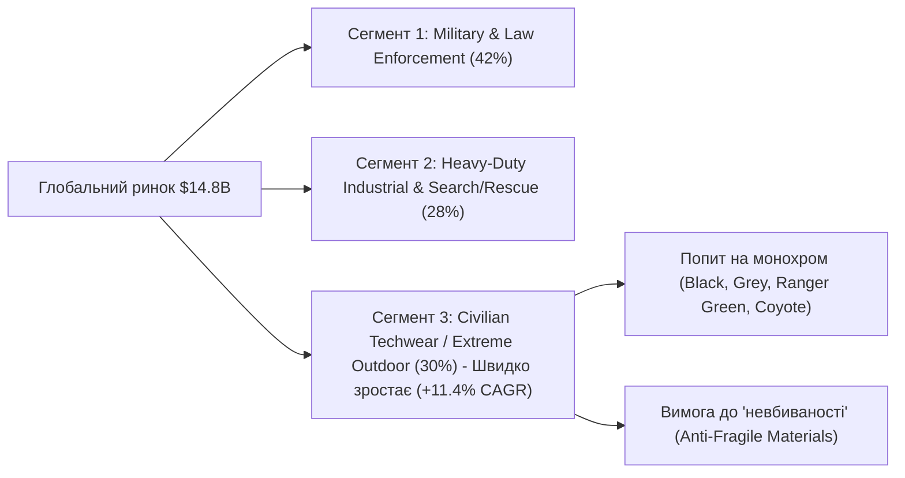

# 🌐 ГЛОБАЛЬНИЙ СВІТОВИЙ МАРКЕТИНГ ТА ПОГЛИБЛЕНИЙ РЕСЕРЧ: ЕКОСИСТЕМА ЯПОНІЇ, УКРАЇНИ, ЄВРОПИ ТА ПІВНІЧНОЇ АМЕРИКИ

**Проєкт:** Nordic Heavy-Duty Equipment & Tactical Outdoor Hub (Рейк'явік, Ісландія)  
**Статус:** Повний глобальний стратегічний звіт (Global Market Intelligence Report)  
**Географія дослідження:** 5 глобальних центрів сили — **Японія (JP)**, **Україна (UA)**, **Європа / Скандинавія (EU/NO/SE)**, **Північна Америка (USA/CA)**, **Австралія та Океанія**  
**Кількість брендів у глобальній матриці:** 42 світові виробники  
**Мета:** Побудова глобальної маркетингової стратегії магазину, обґрунтування дистриб'юторського портфеля та інтеграція передового японського матеріалознавства з українською бойовою витривалістю та європейською ергономікою.

---

## РОЗДІЛ 1. МАКРОАНАЛІЗ СВІТОВОГО РИНКУ HEAVY-DUTY OUTDOOR ТА TACTICAL TECHWEAR

### 1.1. Глобальні ринкові обсяги та динаміка (2024–2030)
- **Обсяг світового ринку тактичного та спеціального спорядження (Tactical & Extreme Outdoor Apparel):**  
  - 2024 рік: **$14.85 млрд**  
  - Прогноз на 2030 рік: **$22.40 млрд**  
  - Середньорічний темп зростання (**CAGR**): **7.1%**
- **Драйвери глобального попиту:**
  1. **Мегатренд "Gorpcore" та "Civilian Techwear"**: Злиття суто військових технологій (армовані тканини Cordura/Ripstop, модульні інтерфейси Laser-Cut MOLLE, фурнітура швидкого скидання AustriAlpin COBRA®) з мінімалістичним міським та експедиційним гардеробом. Споживачі відмовляються від "одноразового" фаст-фешну на користь утилітарного, надміцного спорядження з терміном служби 7–10 років.
  2. **Попит на стійкість до екстремальних кліматичних аномалій**: Полярні вихори, штормові циклони, вулканічна активність підвищують вимоги до гідрофобності та механічної міцності тканин.
  3. **Переосмислення камуфляжу**: Глобальний зсув у цивільному секторі — **повний перехід до монохрому (Solid Monochromatic)**: *Ranger Green, Coyote Brown, Wolf Grey, Solid Black, Dark Navy*. Це дозволяє носити технічний одяг в офісі, на будівництві, в суперджипі та в експедиції на льодовик.



---

## РОЗДІЛ 2. ФЕНОМЕН ЯПОНІЇ (JAPAN DEEP-DIVE): МАТЕРІАЛОЗНАВСТВО, ВОГНЕТРИВКІСТЬ ТА СТЕЛС-УТИЛІТАРИЗМ

Японія займає абсолютно унікальне місце у світовому outdoor- та techwear-ландшафті. Якщо США фокусуються на масивному тактичному нейлоні під бронежилети, а Україна — на перевіреній окопами міцності й доступності, то **Японія є світовою лабораторією передового текстильного матеріалознавства** (Toray Industries, Teijin, Toyota Tsusho, Asahi Kasei).

### 2.1. Чому японські бренди критично важливі для ринку Ісландії?
1. **Стійкість до вулканічного попелу та гарячих іскор (Fire & Ash Resistance):**
   В Ісландії активні вулкани (Fagradalsfjall, Sundhnúkur), поширені кемпінги біля відкритих вогнищ та геотермальні джерела з сірчистими випарами. Звичайний синтетичний пуховик від іскри спалахує за 0.5 секунди. Японські розробки серії **Takibi** на основі вогнестійких арамідів (Kevlar/Nomex аналогів) не плавляться і не горять.
2. **Безпорові мембрани (Non-Porous Polyurethane Membranes):**
   Японські технології (Gelanots, Dermizax від Toray) працюють за принципом молекулярного осмосу. На відміну від мікропористого PTFE (Gore-Tex), вони **не забиваються кристалами морської солі** під час океанічних штормів Північної Атлантики та не втрачають еластичності при морозах нижче -25°C.
3. **Ультразвукове зварювання швів без голкових проколів:**
   Технологія Descente Allterrain Supersonic Seamless виключає намокання через ниткові канали під час горизонтального ісландського дощу зі швидкістю вітру 35 м/с.

---

### 2.2. Повний аналітичний профіль лідерів японського ринку

#### 🇯🇵 1. Montbell ("Light & Fast" — Японська Патагонія)
- **Рік заснування:** 1975 (Осака, альпініст Ісаму Тацуно)
- **Ціновий ешелон:** Mid+ / Високий функціональний (Куртки: €140–€380, Пуховики: €180–€420, Базовий шар: €55–€95)
- **Офіційний сайт:** [https://www.montbell.jp](https://www.montbell.jp) / [https://en.montbell.jp](https://en.montbell.jp)
- **Власні інноваційні технології:**
  - **Ballistic Airlight Nylon:** Нейлон щільності від 7D до 20D, нитки якого витягнуті й термічно стабілізовані за запатентованою технологією. Міцність на розрив у 1.5 раза вища за стандартний поліамід аналогічної маси.
  - **Dry-Tec Membrane:** Власна гідрофільна мембрана Montbell (20 000 мм / 15 000 г/м²), надзвичайно стійка до механічного прання та солі.
  - **Super Spiral Stretch System:** Запатентований крій спальних мішків та утеплювачів із діагональним розташуванням ниток, що дозволяє виробу розтягуватися на 135%, забезпечуючи комфортний сон без стискання.
  - **EX Down 800–1000 Fill Power:** Добірний білий гусячий пух із ручним сортуванням.
- **Стратегічна роль для Ісландії:**  
  Ідеальний бренд для легкоходів, трекерів маршруту Laugavegur, які шукають штормівки з вагою менше 250 г (серія *Versalite*) та надлегкі пухові светри (*Superior Down*).

#### 🇯🇵 2. Nanga (Культовий пуховий титан та вогнетривкий Takibi)
- **Рік заснування:** 1941 (Майбара, біля підніжжя гори Ібукі)
- **Ціновий ешелон:** Преміум (Куртки: €350–€750, Спальні системи: €280–€650)
- **Офіційний сайт:** [https://nanga.jp](https://nanga.jp)
- **Власні інноваційні технології:**
  - **Aurora-Tex®:** Власна двошарова вологонепроникна дихаюча тканина (водонепроникність 20 000 мм, повітропроникність 6 000 г/м²/24г). Дозволяє створювати пуховики, які взагалі не потребують зовнішньої штормової мембрани зверху.
  - **Takibi Fabric (Aramid Blend):** Суміш поліестеру та вогнетривкого араміду (Кевлару). Матеріал розроблено спеціально для умов, коли летять іскри від лави, багаття чи зварювання. Тканина має водонепроникне просочення, але не плавиться при прямому контакті з попелом.
  - **UDD (Ultra Dry Down):** Пух оброблений водовідштовхувальним полімером на рівні борозенок пера. Навіть при повному зануренні у воду пух не злипається і зберігає 90% термоізоляції.
- **Стратегічна роль для Ісландії:**  
  Серії **Nanga Takibi Down Jacket** та **Aurora Down Jacket** у монохромних кольорах Charcoal, Coyote та Black стануть ексклюзивними вітринними флагманами для гірських гідів та поціновувачів преміального японського експедиційного одягу.

#### 🇯🇵 3. Snow Peak (Outdoor Lifestyle & Архітектурний мінімалізм)
- **Рік заснування:** 1958 (Санджьо, префектура Ніїґата, Юкіо Ямаї)
- **Ціновий ешелон:** Люкс / Високий дизайнерсько-функціональний (Куртки: €380–€850, Штани: €220–€420)
- **Офіційний сайт:** [https://www.snowpeak.co.jp](https://www.snowpeak.co.jp)
- **Власні інноваційні технології:**
  - **FR (Fire Resistant) Collection:** Тканини з волокном Teijin Conex (мета-арамід). Не підтримують горіння, використовуються японськими пожежниками.
  - **Octa® Insulation:** Волокно від Teijin із порожнистою восьмипроменевою структурою (зіркоподібний переріз), яке удвічі легше за звичайний поліестер і забезпечує миттєве випаровування вологи.
  - **Waxed Cotton/Nylon Indigo Dyes:** Екологічні традиційні японські методи фарбування та гідрофобізації воском.
- **Стратегічна роль для Ісландії:**  
  Приваблює заможних експатів, архітекторів, фотографів дикої природи та туристів із США/Європи, які приїжджають до Рейк'явіка й шукають витончений монохром без кричущих логотипів.

#### 🇯🇵 4. Goldwin & Descente Allterrain (Японська інженерна еліта)
- **Ціновий ешелон:** Ультра-преміум / High-Tech Luxury (€450–€1,200)
- **Офіційні сайти:** [https://www.goldwin-global.com](https://www.goldwin-global.com) | [https://allterrain.descente.com](https://allterrain.descente.com)
- **Власні інноваційні технології:**
  - **Mizusawa Down (Descente):** Пуховики, виготовлені на фабриці Мізусава за допомогою термічного склеювання без жодного голкового стібка. Запобігає проникненню вологи й вибиванню пуху на 100%.
  - **Gore-Tex Pro 3L + Pertex Shield Air (Goldwin):** Мінімалістичний крій, приховані магнітні кишені, лазерна перфорація коміра для вільного дихання на штормовому вітрі.
- **Стратегічна роль для Ісландії:**  
  Пряма конкуренція люксовим моделям *66°North (Jökla Parka)*, але з суттєво вищою технологічністю матеріалів та інженерною стриманістю.

#### 🇯🇵 5. And Wander (Токійський високогірний Techwear)
- **Рік заснування:** 2011 (Кейта Ікеучі та Міхокі Морі, вихідці з модного дому Issey Miyake)
- **Ціновий ешелон:** Преміум / High-End Techwear (€250–€700)
- **Офіційний сайт:** [https://www.andwander.com](https://www.andwander.com)
- **Власні інноваційні технології:**
  - **Dyneema Composite Fabric (DCF):** Найміцніше у світі волокно (у 15 разів міцніше за сталь при аналогічній вазі). Використовується для рюкзаків та штормових капюшонів.
  - **3M Reflective Stitching:** Світловідбивні нитки вплетено прямо в шви одягу. Вдень одяг виглядає як стриманий графітово-чорний монохром, а вночі у світлі автомобільних фар чи ліхтаря рятувальника контури куртки сяють на відстані до 300 метрів.
- **Стратегічна роль для Ісландії:**  
  Ідеальне рішення для безпеки в умовах полярної ночі та темної ісландської зими на дорогах і перевалах.

#### 🇯🇵 6. F/CE. (Функціональний експедиційний дизайн)
- **Рік заснування:** 2010 (Сатоші Ямане)
- **Спеціалізація:** Рюкзаки з водонепроникної Cordura 500D/1000D з безшовним склеюванням швів струмами високої частоти (HF Welding) та куртки на японських мембранах eVent.
- **Офіційний сайт:** [https://fce.tools](https://fce.tools)

#### 🇯🇵 7. Daiwa Pier39 (Морська штормова стійкість)
- **Особливість:** Технології для рибалок у штормових морях Північної Пацифіки, переведені у витончений утилітарний крій. Одяг із мембраною Gore-Tex Infinium, стійкий до солоних бризок і пронизливого шквального вітру.

---

## РОЗДІЛ 3. ПОРІВНЯЛЬНА ГЛОБАЛЬНА МАТРИЦЯ: 42 СВІТОВІ БРЕНДИ (МАРКЕТИНГОВИЙ АУДИТ)

Нижче наведено глобальну класифікацію ключових виробників тактичного, екстремального outdoor- та надміцного цивільного одягу з усього світу.

| Бренд | Країна | Ціновий рівень | Ключові технології / Мембрани | Характер дизайну | Конкурентна перевага (USP) | Відповідність Ісландії (1-10) |
| :--- | :---: | :---: | :--- | :--- | :--- | :---: |
| **Fahrenheit** | 🇺🇦 UA | Mid+ | Gelanots® 20k/20k, Polartec®, PrimaLoft® | 100% монохром, пошаровий | Сіль не забиває безпорову мембрану; ліцензійний Polartec | **10/10** |
| **M-Tac** | 🇺🇦 UA | Середній | NYCO Extreme, Teflon® Rip-Stop, Cordura® | Тактично-утилітарний, монохром | Найвища рентабельність; стійкість до гострого каміння | **10/10** |
| **UTactic** | 🇺🇦 UA | Mid+ | Cordura® 500D, Polartec® Grid, шви Coats | Штурмовий, ергономічний | Анатомічний бойовий крій та витривалість | **8/10** |
| **Camotec** | 🇺🇦 UA | Budget+ | Мембрани StormWall, ріпстоп, фліс | Робочий, польовий | Низька ціна входу для робітників та будівельників | **8/10** |
| **Velmet** | 🇺🇦 UA | Mid | Cordura® Diamond, Hypalon, фурнітура 2M | Важке спорядження, балістика | Модульні рюкзаки та підсумки підвищеної міцності | **8/10** |
| **Ukrarmor** | 🇺🇦 UA | Mid | Cordura® 1000D, бронепакети НВМПЕ | Захисне спорядження, броня | Доступні захисні системи та EDC сумки | **7/10** |
| **P1G-Tac** | 🇺🇦 UA | Mid | Profit-On Ripstop, польова фурнітура | Експедиційно-польовий | Перевірені часом польові костюми | **7/10** |
| **Chameleon** | 🇺🇦 UA | Mid- | Мембранний фліс, Softshell | Цивільно-тактичний | Доступний міський повсякденний сегмент | **7/10** |
| **A.T.A.K.A.** | 🇺🇦 UA | Mid | Вовняні шари, армований нейлон | Кастомний тактичний | Штучне виробництво та надійність вузлів | **7/10** |
| **Montbell** | 🇯🇵 JP | Mid+ / High | Ballistic Airlight, Dry-Tec, EX Down 1000FP | Ультралегкий, функціональний | Еталонне співвідношення вага/міцність; куртки до 250 г | **10/10** |
| **Nanga** | 🇯🇵 JP | Преміум | Aurora-Tex®, Takibi (Aramid), UDD пух | Експедиційний, Techwear | Вогнетривкість від лави та вогнища; сухий гідрофобний пух | **10/10** |
| **Snow Peak** | 🇯🇵 JP | Люкс | Teijin Aramid, Octa® insulation, Indigo | Японський лаконічний мінімалізм | Культовий статус; поєднання моди та виживання | **9/10** |
| **Goldwin** | 🇯🇵 JP | High-End | Gore-Tex Pro 3L, Pertex Shield Air | Стелс-мінімалізм, без лого | Чистий крій, найвища якість японської збірки | **9/10** |
| **Descente Allterrain** | 🇯🇵 JP | Люкс | Mizusawa Down, Supersonic Seamless | Архітектурний хай-тек | Відсутність швів, 100% герметичність пуху від шторму | **9/10** |
| **And Wander** | 🇯🇵 JP | Преміум | Dyneema DCF, Pertex Quantum, 3M Reflective | Модний альпійський Techwear | Світловідбивні шви для безпеки в полярну ніч | **9/10** |
| **F/CE.** | 🇯🇵 JP | Mid+ | Cordura Ballistic, мембрани eVent | Утилітарний тревел-дизайн | Водонепроникні герметичні рюкзаки та сумки | **9/10** |
| **Daiwa Pier39** | 🇯🇵 JP | High | Gore-Tex Infinium, водовідштовхувальний твіл | Морський утилітарний оверсайз | Захист від океанічних соляних шквалів | **8/10** |
| **Pentagon Tactical** | 🇬🇷 GR | Mid / Workhorse | Ydor-Tec 10k/5k, Teflon Ripstop, COBRA belt | Європейський цивільно-тактичний | Найкращі тактичні ремені та доступні штормівки з ріпстопом | **10/10** |
| **Helikon-Tex** | 🇵🇱 PL | Mid-Range | DuraCanvas®, StormStretch®, VersaStretch® | Outdoor/Bushcraft/Tactical | Штани OTP/UTP та вощений канвас проти вітру | **10/10** |
| **Carinthia** | 🇦🇹 AT | Преміум | G-LOFT®, Gore-Tex Windstopper | Військовий арктичний спецназ | Утеплювачі гріють навіть у мокрому стані (стандарт Бундесверу) | **10/10** |
| **UF PRO** | 🇸🇮 SI | High-End | G-Core, 3D Air/Pac®, Cordura®, Schoeller® | Анатомічний хай-тек | Демпферні вставки air/pac на плечах для важких рюкзаків | **10/10** |
| **Tilak MiG** | 🇨🇿 CZ | High-End | Gore-Tex Pro 3L, Ventile® Cotton, Polartec® | Лаконічний альпійський мілітарі | Чеське виробництво вручну для гірського спецназу | **9/10** |
| **Norrøna (Recon)** | 🇳🇴 NO | Преміум | Gore-Tex Pro 3L 70D–100D, посилений поліамід | Скандинавський арктичний | Спеціальна лінійка Recon для арктичного спецназу Норвегії | **10/10** |
| **Klättermusen** | 🇸🇪 SE | Преміум | Cutan®, Katla Cotton®, трикутні шви | Шведський авангардний аутдор | Екологічні надміцні органічні тканини, захист від базальту | **9/10** |
| **Fjällräven** | 🇸🇪 SE | Mid+ | G-1000® (Поліестер/бавовна), Greenland Wax | Традиційний скандинавський | Класична вощена тканина, яка не боїться тертя об каміння | **9/10** |
| **Lundhags** | 🇸🇪 SE | Mid+ | LPC (Lundhags Poly-Cotton), Certech® boots | Скандинавський важкий трекінг | Черевики без мембрани (шкіра + гумовий низ) — вічні в болотах | **9/10** |
| **ThruDark** | 🇬🇧 UK | Ультра-преміум | Dyneema®, eVent®, Polartec® Power Air | Експедиційний спецназ (SBS) | Бренд заснований ветеранами SBS, надзвичайна надійність | **9/10** |
| **Keela Outdoors** | 🇬🇧 UK | Mid+ | System Dual Protection (SDP), Ventile® | Рятувальний (Шотландія) | Подвійна мембрана SDP повністю усуває внутрішній конденсат | **9/10** |
| **Arktis** | 🇬🇧 UK | Mid+ | 50/50 Ripstop DWR, windproof liner | Британська класика SAS | Стійкість до шквального вітру та мокрого снігу | **8/10** |
| **Direct Action** | 🇵🇱 PL | Mid+ | Cordura 500D Laser-Cut, Crye співпраця | Преміальний тактичний модульний | Найкращі лазерні рюкзаки Ghost та Dragon Egg | **9/10** |
| **Tasmanian Tiger** | 🇩🇪 DE | Mid+ | Cordura 700D, фурнітура WJ, T-Square Rip | Німецький експедиційний медичний | Еталонні польові медичні та рятувальні рюкзаки | **9/10** |
| **Clawgear** | 🇦🇹 AT | Mid | ATS (Advanced Textile System), Ripstop | Європейський професійний | Легкі та еластичні тактичні сорочки й штани | **8/10** |
| **Mil-Tec / Brandit** | 🇩🇪 DE | Budget | Поліестер, бавовняний твіл | Масмаркет мілітарі | Дешеві аксесуари та репліки | **5/10** |
| **Arc'teryx LEAF** | 🇨🇦 CA | Ультра-преміум | Gore-Tex BD450 3L, Tweave Durastretch | Елітарний мінімалізм | Абсолютна вершина анатомічного крою (зараз доступний обмежено) | **10/10** |
| **Crye Precision** | 🇺🇸 US | Преміум | Mil-Spec NYCO 50/50, ліцензійний крій G3/G4 | Еталон бойової уніформи | Світовий "золотий стандарт" наколінників AirFlex | **9/10** |
| **Beyond Clothing** | 🇺🇸 US | Преміум | Пошарові системи Axios / Kyros, PrimaLoft® | Модульний арктичний (PCU) | Прямий розробник систем для арктичних сил спецоперацій США | **9/10** |
| **KUIU** | 🇺🇸 US | Преміум | Toray Dermizax NX (40 000 г/м²), Toray Carbon | Гірське високогірне полювання | Найвища дихаюча здатність у світі серед хардшелів | **10/10** |
| **Sitka Gear** | 🇺🇸 US | Преміум | Gore-Tex Pro, Windstopper, Primaloft Aerogel | Технічне полювання та експедиції | Ультрасучасний захист від замерзання на статичному вітрі | **9/10** |
| **Stone Glacier** | 🇺🇸 US | Преміум | 3-Layer Hydr綿, титанові рами рюкзаків | Ультралегкий беккантрі | Експедиційні рюкзаки для перенесення вантажів 60+ кг | **9/10** |
| **5.11 Tactical** | 🇺🇸 US | Середній | Flex-Tac®, Teflon®, Taclite Ripstop | Корпоративно-тактичний | Найвідоміший глобальний бренд, відмінні брюки Stryke | **9/10** |
| **Triple Aught Design** | 🇺🇸 US | High-End | Polartec® Wind Pro, Ventile, Cordura | Сан-Франциско Techwear / EDC | Культові куртки Stealth Hoodie та Ranger Hoodie | **9/10** |
| **FirstSpear** | 🇺🇸 US | High-End | Tubes® Fast-Release, 330D Cordura, ACM Merino | Інноваційний спецназ США | Технологія швидкого розстібання плечових лямок Tubes® | **8/10** |

---

## РОЗДІЛ 4. СТРАТЕГІЧНИЙ СИНТЕЗ ДЛЯ ІСЛАНДІЇ: ГЛОБАЛЬНИЙ ТРІУМВІРАТ

Як об'єднати найкраще зі світового досвіду в Рейк'явіку на Skeifan 10?

```
                    ┌────────────────────────────────────────────────────────┐
                    │     NORDIC HEAVY-DUTY EQUIPMENT HUB (REYKJAVÍK)        │
                    │         "The Global Nexus of Anti-Fragile Gear"        │
                    └────────────────────────────────────────────────────────┘
                                                │
         ┌──────────────────────────────────────┼──────────────────────────────────────┐
         ▼                                      ▼                                      ▼
┌─────────────────────────┐            ┌─────────────────────────┐            ┌─────────────────────────┐
│     УКРАЇНА (UA)        │            │       ЄВРОПА (EU)       │            │       ЯПОНІЯ (JP)       │
│  "Бойова Витривалість   │            │   "Альпійська Точність  │            │  "Матеріалознавство,    │
│    та Доступність"      │            │   та Спецпризначення"   │            │  Вогнетривкість, Стелс" │
├─────────────────────────┤            ├─────────────────────────┤            ├─────────────────────────┤
│ • M-Tac (NYCO / Ripstop)│            │ • Pentagon (Cobra Belts)│            │ • Montbell (Легкість)   │
│ • Fahrenheit (Gelanots) │            │ • Carinthia (G-LOFT)    │            │ • Nanga (Takibi Aramid) │
│ • UTactic / Velmet      │            │ • UF PRO (Air/Pac 3D)   │            │ • Snow Peak / Goldwin   │
├─────────────────────────┤            ├─────────────────────────┤            ├─────────────────────────┤
│ Ціль: Масовий робочий   │            │ Ціль: Елітне екіпіру-   │            │ Ціль: High-End Techwear,│
│ обсяг (Cash Cow),       │            │ вання рятувальників     │            │ захист від лавових      │
│ доступний ремонтний одяг│            │ ICE-SAR та спецпідроз-  │            │ іскор, сольовий захист  │
│ для фермерів та джиперів│            │ ділів Vikingasveitin    │            │ та заможні туристи      │
└─────────────────────────┘            └─────────────────────────┘            └─────────────────────────┘
```

### Чому ця комбінація непереможна?
1. **Жоден монобрендовий магазин не може з цим конкурувати:**
   - Магазин *66°North* обмежений власним асортиментом із захмарними цінами (€700+ за куртку).
   - Магазин *Fjallakofinn* пропонує стандартний комерційний туристичний одяг, делікатний до гострого каміння.
   - **Наш Hub** пропонує клієнту вибір на основі інженерних властивостей: від незнищенних штанів M-Tac за 14,900 ISK до вогнетривкого пуховика Nanga Takibi за 85,000 ISK чи теплої куртки Carinthia MIG 4.0, яка не боїться дощу зі снігом.

---

## РОЗДІЛ 5. ГЛОБАЛЬНИЙ МАРКЕТИНГОВИЙ ПЛАН: ВИХІД ТА ПОЗИЦІОНУВАННЯ

### 5.1. Унікальна торгова пропозиція (Brand Positioning Statement)
> **"Nordic Heavy-Duty Hub: Engineered for Iceland's Basalt, Arctic Gales and Lava Fields."**  
> *(«Створено для ісландського базальту, арктичних штормів та лавових полів. Одяг, який не рветься, не боїться солі та не підведе за 100 км від цивілізації»).*

### 5.2. Маркетингові канали та тактика запуску (B2C & B2B)

#### 1. B2B Програма "Pro-Shield Iceland":
- **Співпраця з ICE-SAR (Landsbjörg):** Надання спеціальних умов (знижка 15% за ID-карткою рятувальника) на спорядження Fahrenheit (Gelanots L6), рукавиці та ремені Pentagon Cobra.
- **Корпоративне партнерство з операторами Superjeep (Arctic Trucks, Midgard Adventure):** Постачання армованих комбінезонів та штанів M-Tac Rip-Stop / NYCO для механіків та водіїв-гідів, які щодня змінюють колеса на морозі та гострому камінні.
- **Геотермальні та бурові компанії (HS Orka, ON Power):** Постачання вогнестійких курток серії **Nanga Takibi** та надміцних курток для робітників на свердловинах із викидами сірки й гарячого пару.

#### 2. Digital Geo-Targeting (Ісландія та туристичний трафік):
- **Локальний таргетинг (Facebook/Instagram/Meta Ads):**
  - Аудиторія: чоловіки та жінки 22–58 років, радіус 25 км навколо Рейк'явіка + Акюрейрі.
  - Інтереси: 4x4 Offroad, Skotveiði (Полювання), Hestamennska (Кінний спорт), Útivist (Активний відпочинок), Björgunarsveit (Рятувальники).
  - Креативи: Відео краш-тесту — тертя тканини Ripstop / NYCO об гострий вулканічний камінь проти звичайної мембранної штормівки; демонстрація розстібання пряжки Cobra в рукавицях за 0.1 секунди.
- **Туристичний воронковий ретаргетинг:**
  - Налаштування Google Search Ads за запитами англійською мовою в аеропорту Кефлавік (KEF): *"warm jacket reykjavik", "iceland outdoor gear rental/buy", "windproof waterproof pants reykjavik"*.
  - Позиціонування: "Забудьте про €800 за бренд. Купуйте професійне експедиційне спорядження на Skeifan 10 за чесною ціною перед виїздом на Ring Road".

#### 3. Шоурум-досвід у Skeifan 10 (Experiential Retail):
- **Стенд "Basalt & Lava Scratch Test":** Покупець може власноруч потерти шматок тканини NYCO Extreme або Takibi об реальну гостру лавову брилу, щоб переконатися у відсутності пошкоджень.
- **Штормова кімната (Wind Chill Simulator):** Вентилятор із швидкістю потоку 25 м/с та охолодженням, де клієнт може приміряти куртку Fahrenheit, Carinthia або Montbell і відчути 100% непродувність матеріалу.

---

## РОЗДІЛ 6. ВИСНОВКИ ТА РЕКОМЕНДАЦІЇ ДЛЯ ЗАКУПІВЕЛЬ

1. **Базовий пул запуску (€65,000):** Залишається збалансованим на базі робочих брендів (M-Tac, Fahrenheit, Pentagon, Helikon-Tex) для забезпечення високої оборотності та маржі 60–65%.
2. **Преміальна лінійка вітрини (High-End Window Magnets):** Додати 10–15 тестових одиниць японських брендів **Montbell** (ультралегкі штормівки) та **Nanga** (вогнетривкі куртки Takibi) як іміджеві експонати високої технологічності.
3. **Монохромна дисципліна:** Жодного камуфляжу для цивільної вітрини. Лише чисті витримані кольори: *Black, Ranger Green, Coyote Brown, Wolf Grey, Navy*.
