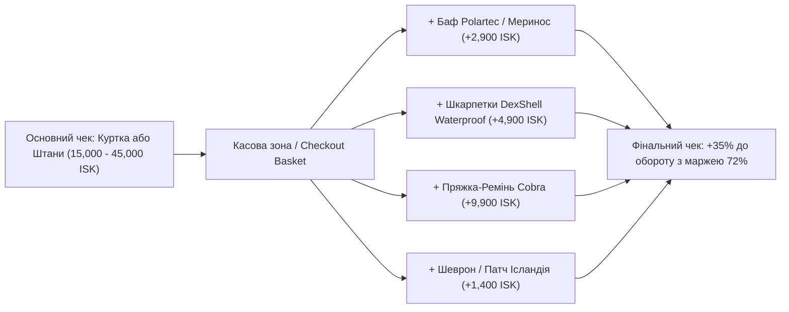

# ⚡ ГЛИБИННИЙ РЕСЕРЧ ТА СТРАТЕГІЯ ІМПУЛЬСНИХ ТОВАРІВ НАДВИСОКОЇ МАРЖИНАЛЬНОСТІ (HIGH-MARGIN IMPULSE & EDC CHECKOUT MERCHANDISING)

**Проєкт:** Nordic Heavy-Duty Equipment & Tactical Outdoor Hub (Рейк'явік, Skeifan 10)  
**Ціль дослідження:** Максимізація середнього чека (AOV), розгін маржинальності до 65–85% та захоплення імпульсивного попиту туристів і місцевих жителів біля касової зони.  
**Специфіка Ісландії:** Вулканічний абразивний пил, ураганний вітер, крижаний дощ біля водоспадів, темрява полярної ночі (20 год темряви взимку), перепади температур, оффроуд 4x4.

---

## РОЗДІЛ 1. ЕКОНОМІКА КАСОВОЇ ЗОНИ ТА ПСИХОЛОГІЯ ІМПУЛЬСНОЇ ПОКУПКИ (AOV EXPANSION)

### 1.1. Чому імпульсні товари — це 30% чистого прибутку роздрібного магазину?
1. **Зниження психологічного порогу ціни:** Коли покупець уже прийняв рішення купити куртку за 38,000 ISK (€240) або штани за 14,900 ISK (€95), додавання товару вартістю 1,900 – 4,900 ISK (€12–€32) сприймається як незначна доплата, яка не впливає на бюджет.
2. **Миттєве вирішення гострого болю («Emergency Need»):** Турист, який щойно прилетів, часто забуває дрібниці: захист телефону від водяного пилу водоспаду Скоґафосс, теплий баф на обличчя від штормового вітру, хімічну грілку для пальців, ліхтарик для темного вечора чи надійні водонепроникні шкарпетки.
3. **Надзвичайно висока маржинальність (Markup 2.8x – 5.0x):** Якщо на складних куртках з мембраною маржа коливається в межах 50–58%, то на патчах, карабінах, бафах, ліхтариках та хімічних грілках маржинальність досягає **68% – 85%**.



---

## РОЗДІЛ 2. ТОП-12 КАТЕГОРІЙ ІМПУЛЬСНИХ ТОВАРІВ ДЛЯ РЕЙК'ЯВІКА

Нижче наведено детальний ресерч 12 категорій додаткового асортименту, адаптованого саме під екстремальний субарктичний побут Ісландії.

---

### 🧦 КАТЕГОРІЯ 1. Водонепроникні та експедиційні мембранні шкарпетки
- **Бренди:** **DexShell**, **Sealskinz**, **Fahrenheit (Merino Heavy)**.
- **Біль клієнта в Ісландії:** Перетин річок у брід, мокрий мох, протікання взуття біля гейзерів та водоспадів. Мокрі ноги при температурі +2°C та вітрі 20 м/с призводять до гіпотермії за 40 хвилин.
- **Технологія:** 3-шарова конструкція: зовнішній зносостійкий нейлон, тонка еластична безпорова мембрана *Porelle®* (10 000 мм вологозахисту) та внутрішній шар із натуральної вовни мериноса (Merino Wool). Навіть якщо черевик наскрізь залитий водою, нога залишається сухою й теплою.
- **Фінансова модель:**
  - Оптова ціна: **€11.50 – €14.00**
  - Роздрібна ціна: **€36.00 – €44.00** (5,700 – 6,900 ISK)
  - Валова маржа: **68% – 71%**

---

### 🧤 КАТЕГОРІЯ 2. Тактичні та фотографічні рукавиці з відкидним пальцем
- **Бренди:** **Mechanix Wear (ColdWork WindShell)**, **Pentagon (Duty Grip)**, **M-Tac (Winter Windblock)**, **Carinthia (Touch Gloves)**.
- **Біль клієнта в Ісландії:** Неможливо фотографувати на дрон або телефон у звичайних громіздких лижних рукавицях; руки відмерзають миттєво.
- **Технологія:** Вітрозахисний мембранний фліс Windblock/Windstopper, сенсорні накладки Touchscreen на кінчиках пальців або відкидний клапан «Trigger Finger» на магніті, анатомічна долоня з синтетичної замші Clarino проти ковзання керма суперджипа.
- **Фінансова модель:**
  - Оптова ціна: **€9.00 – €18.00**
  - Роздрібна ціна: **€28.00 – €55.00** (4,400 – 8,700 ISK)
  - Валова маржа: **67% – 70%**

---

### 🧣 КАТЕГОРІЯ 3. Термобафи, балаклави та шийні гейтери (Wind-Shield)
- **Бренди:** **Fahrenheit (Polartec Power Stretch / Power Grid)**, **Buff (Merino Wool 250g)**, **Helikon-Tex**.
- **Біль клієнта в Ісландії:** Вітер зі швидкістю 30 м/с пробиває будь-який комір куртки. Обличчя обвітрюється і лущиться за 2 години перебування на чорному пляжі Рейнісф'яра.
- **Технологія:** Оригінальний Polartec Power Stretch Pro з водовідштовхувальним зовнішнім нейлоновим шаром або 100% шерсть мериноса, яка гріє навіть у вологому стані та не вбирає запахи.
- **Фінансова модель:**
  - Оптова ціна: **€4.50 – €8.50**
  - Роздрібна ціна: **€18.00 – €29.00** (2,800 – 4,600 ISK)
  - Валова маржа: **70% – 75%**

---

### 🔦 КАТЕГОРІЯ 4. Налобні та кишенькові тактичні ліхтарі (Polar Night Ready)
- **Бренди:** **Petzl (Actik Core / Tactikka)**, **Nitecore (NU25 / EDC27)**, **Olight**, **Princeton Tec**.
- **Біль клієнта в Ісландії:** З листопада по лютий світловий день триває лише 4 години (з 11:30 до 15:30). Решта 20 годин — темрява. Без ліхтаря будь-яка прогулянка за межами міста смертельно небезпечна.
- **Технологія:** USB-C зарядка, герметичний вологозахист IPX8 (витримує падіння в річку), додатковий режим **червоного світла** (зберігає нічний зір при спостереженні за Північним сяйвом — Aurora Borealis).
- **Фінансова модель:**
  - Оптова ціна: **€14.00 – €24.00**
  - Роздрібна ціна: **€42.00 – €68.00** (6,600 – 10,800 ISK)
  - Валова маржа: **65% – 67%**

---

### 🚨 КАТЕГОРІЯ 5. Маячки персональної безпеки та світловідбивні кліпси
- **Бренди:** **Guardian Angel Micro Device**, **Glo-Toob (Nextorch)**, **Nite Ize (TagLit / SpotLit)**.
- **Біль клієнта в Ісландії:** На сільських дорогах і перевалах Ісландії немає ліхтарів. Пішоходи на узбіччі непомітні водіям у хуртовину.
- **Технологія:** Компактні магнітні світлодіодні маячки з оглядом на 360 градусів, видимістю до 3–5 км, які кріпляться на плече, капюшон або нашийник собаки.
- **Фінансова модель:**
  - Оптова ціна: **€6.00 – €16.00**
  - Роздрібна ціна: **€22.00 – €48.00** (3,500 – 7,600 ISK)
  - Валова маржа: **67% – 72%**

---

### 🎒 КАТЕГОРІЯ 6. Гермомішки (Dry Bags) та захисні чохли для гаджетів
- **Бренди:** **Sea to Summit (Ultra-Sil Dry Sack)**, **M-Tac Waterproof Dry Bag**, **F/CE. (Seamless Dry Pouch)**.
- **Біль клієнта в Ісландії:** Біля водоспадів (Seljalandsfoss, Gullfoss) водяний пил настільки щільний, що заливає паспорти, камери та телефони в кишенях.
- **Технологія:** Силіконізований нейлон Cordura Rip-Stop щільністю 30D/70D з поліуретановим ламінуванням та проклеєними швами. Об'єми 3L, 5L, 10L, 20L.
- **Фінансова модель:**
  - Оптова ціна: **€3.80 – €9.50**
  - Роздрібна ціна: **€15.00 – €32.00** (2,400 – 5,100 ISK)
  - Валова маржа: **70% – 75%**

---

### 🔥 КАТЕГОРІЯ 7. Хімічні та електронні USB-грілки для рук і ніг
- **Бренди:** **Only Hot (Італія)**, **Grabber (США)**, **Zippo HeatBank (USB)**, **Ocoopa**.
- **Біль клієнта в Ісландії:** Замерзання кінцівок під час очікування Аврори або зміни пробитого колеса суперджипа. На морозі батарея iPhone сідає за 10 хвилин.
- **Технологія:**
  - *Хімічні:* пакети з активованим залізом та вугіллям, що активуються киснем і тримають тепло 8–10 годин при температурі 55°C.
  - *Електронні:* повербанк на 5,000–10,000 мАг, що одночасно гріє кишеню до 50°C та заряджає смартфон.
- **Фінансова модель:**
  - Одноразові пакети: Опт **€0.65** ➔ Продаж **€2.50** (400 ISK) — **Маржа 74%**
  - Електронна USB-грілка: Опт **€12.00** ➔ Продаж **€39.00** (6,200 ISK) — **Маржа 69%**

---

### 🛡️ КАТЕГОРІЯ 8. Тактичні карабіни, ретрактори та паракордові брелоки
- **Бренди:** **ITW Nexus (GrimLoc / Web Dominator)**, **Nite Ize (S-Biner Marine Slidelock)**, **Pentagon Carabiners**.
- **Біль клієнта в Ісландії:** Потрібно швидко пристебнути рукавиці до пояса, щоб їх не здуло штормовим вітром при знятті.
- **Технологія:** Морська нержавіюча сталь, стійка до солі, або ударостійкий ацеталь (GhillieTEX), що не дзвенить і не замерзає на морозі.
- **Фінансова модель:**
  - Оптова ціна: **€0.90 – €3.00**
  - Роздрібна ціна: **€5.50 – €14.00** (850 – 2,200 ISK)
  - Валова маржа: **78% – 83%**

---

### ☕ КАТЕГОРІЯ 9. Термокухлі, вакуумні термоси та небиткі фляги EDC
- **Бренди:** **Stanley PMI (Classic / Trigger-Action)**, **Klean Kanteen (Insulated TKWide)**, **Nalgene (Sustain Oasis)**.
- **Біль клієнта в Ісландії:** Довгі переїзди між локаціями по Ring Road. Гаряча кава чи чай — запорука бадьорості. Вода в звичайних пляшках у багажнику замерзає на камінь.
- **Технологія:** Подвійна вакуумна стінка з нержавіючої сталі 18/8, тримає окріп до 18 годин на морозі, порошкове матове покриття в кольорах *Matte Black, Ranger Green, Hammertone Olive*.
- **Фінансова модель:**
  - Оптова ціна: **€11.00 – €18.00**
  - Роздрібна ціна: **€34.00 – €52.00** (5,400 – 8,200 ISK)
  - Валова маржа: **65% – 68%**

---

### 🩹 КАТЕГОРІЯ 10. Польовий ремонт спорядження та водозахисна хімія
- **Бренди:** **Gear Aid (Tenacious Tape / Seam Grip)**, **Nikwax (TX.Direct / Tech Wash)**, **Storm Care**.
- **Біль клієнта в Ісландії:** Зачепився за гострий камінь лави і порвав намет чи штани за 100 км від найближчого міста.
- **Технологія:** Ультралипка армована стрічка Tenacious Tape (чорна або прозора). Наклеюється за 10 секунд на мокру тканину і тримається роками навіть після прання.
- **Фінансова модель:**
  - Оптова ціна: **€2.90 – €5.50**
  - Роздрібна ціна: **€11.00 – €19.00** (1,700 – 3,000 ISK)
  - Валова маржа: **71% – 74%**

---

### 🔱 КАТЕГОРІЯ 11. Кастомні Velcro-патчі та шеврони (High-End Morale Patches)
- **Бренди:** Власна торгова марка **Nordic Hub Custom**, **M-Tac**, **Violent Little Machine Shop**.
- **Чому це "золота жила":** Туристи обожнюють автентичні сувеніри, а місцеві волонтери та джипери — шеврони приналежності до спільноти.
- **Дизайни для нашого магазину:**
  1. *Subdued Iceland Flag* (монохромний прапор Ісландії в кольорах Black/Grey та Olive/Coyote).
  2. *Viking Runes:* Vegvísir (компас захисту мандрівника), Ægishjálmur (шолом страху/захисту).
  3. *Lava-Proof Survivor:* "Hraun Basalt Tested • Iceland".
  4. *Superjeep 44" Club:* стилізований ліфтований арктичний пікап.
- **Фінансова модель (Власне виробництво):**
  - Собівартість виробництва у фабрики (гурт 500 шт.): **€0.80 – €1.20**
  - Роздрібна ціна біля каси: **€8.00 – €12.00** (1,250 – 1,900 ISK)
  - **Валова маржа: 88% – 92%!** (Найвища маржа серед усіх товарів у роздрібній торгівлі).

---

### 🔪 КАТЕГОРІЯ 12. Компактні тактичні мультитули та кишенькові ножі EDC
- **Бренди:** **Leatherman (Skeletool / Wave+)**, **M-Tac Multi-Tool Type 3**, **Victorinox (SwissTool)**, **Ruike / Civivi**.
- **Біль клієнта в Ісландії:** Підтягнути кріплення снігоступа, відрізати мотузку, полагодити багажник на даху авто, відкрити банку консервів біля льодовика.
- **Технологія:** Нержавіюча сталь 440C / D2 / 154CM з чорним антибліковим оксидуванням (Black Oxide) або титановим напиленням.
- **Фінансова модель:**
  - Оптова ціна: **€16.00 – €42.00**
  - Роздрібна ціна: **€48.00 – €115.00** (7,600 – 18,200 ISK)
  - Валова маржа: **63% – 67%**

---

## РОЗДІЛ 3. ПЛАН ЗАКУПІВЛІ ІМПУЛЬСНОГО ПАКЕТА «CHECKOUT CASH MACHINE» (€7,500)

Для того щоб не розпорошувати бюджет і забезпечити максимальний ефект, виділяємо в межах загального пулу стартову інвестицію **€7,500** на імпульсні товари.

| № | Товарна позиція | Кількість | Опт (FOB) | Сума опту | Роздріб (ISK з VSK) | Роздрібна вартість (EUR) | Очікуваний виторг | Маржа % |
| :-: | :--- | :-: | :-: | :-: | :-: | :-: | :-: | :-: |
| 1 | **DexShell Мембранні водонепроникні шкарпетки** | 80 пар | €12.50 | €1,000 | 5,900 kr. | €37.50 | €3,000 | **67%** |
| 2 | **Fahrenheit / M-Tac Polartec Бафи & Гейтери** | 100 шт. | €5.50 | €550 | 3,200 kr. | €20.00 | €2,000 | **73%** |
| 3 | **Pentagon / M-Tac Рукавиці Windblock Touch** | 70 пар | €11.00 | €770 | 4,800 kr. | €30.50 | €2,135 | **64%** |
| 4 | **Petzl / Nitecore Налобні ліхтарі з червоним режимом** | 40 шт. | €18.00 | €720 | 7,900 kr. | €50.00 | €2,000 | **64%** |
| 5 | **Guardian Angel / Glo-Toob Маячки безпеки** | 40 шт. | €10.00 | €400 | 4,500 kr. | €28.50 | €1,140 | **65%** |
| 6 | **Sea to Summit / M-Tac Dry Bags 5L/10L** | 60 шт. | €5.50 | €330 | 2,700 kr. | €17.00 | €1,020 | **68%** |
| 7 | **Хімічні грілки для рук та стоп Only Hot (пачки)** | 300 шт. | €0.70 | €210 | 450 kr. | €2.80 | €840 | **75%** |
| 8 | **ITW Nexus / Nite Ize Карабіни S-Biner Marine** | 120 шт. | €1.80 | €216 | 1,200 kr. | €7.60 | €912 | **76%** |
| 9 | **Stanley / Klean Kanteen Термокружки 470ml** | 35 шт. | €14.00 | €490 | 6,500 kr. | €41.00 | €1,435 | **66%** |
| 10 | **Gear Aid Tenacious Tape Ремкомплекти для лави** | 60 шт. | €3.20 | €192 | 1,800 kr. | €11.50 | €690 | **72%** |
| 11 | **Кастомні PVC Velcro-патчі (Viking / Iceland Subdued)**| 400 шт. | €0.90 | €360 | 1,600 kr. | €10.00 | €4,000 | **91%** |
| 12 | **M-Tac / Ruike Компактні EDC мультитули/ножі** | 30 шт. | €22.00 | €660 | 9,900 kr. | €63.00 | €1,890 | **65%** |
| 13 | **Pentagon Kula 38 Cobra Belts** | 40 шт. | €22.00 | €880 | 9,900 kr. | €63.00 | €2,520 | **65%** |
| 14 | **Pentagon / M-Tac Teflon Ripstop Бейсболки** | 80 шт. | €8.50 | €680 | 3,900 kr. | €25.00 | €2,000 | **66%** |
| **РАЗОМ** | **Імпульсний пул касової зони** | **1,455 од.** | — | **€7,458** | — | — | **€25,582 (4.04M kr.)** | **70.8% Середня маржа** |

---

## РОЗДІЛ 4. ЗОНУВАННЯ КАСОВОЇ ЗОНИ В SKEIFAN 10 (MERCHANDISING LAYOUT)

```
       ┌─────────────────────────────────────────────────────────────┐
       │                ГОЛОВНА КАСОВА ЗОНА ТА ПРИЛАВОК              │
       ├─────────────────────────────────────────────────────────────┤
       │                                                             │
       │  [ Кавовий автомат для клієнтів ]                           │
       │                                                             │
       │  ┌───────────────────────┐   ┌───────────────────────────┐  │
       │  │  ПАТЧ-СТІНА (VELCRO)  │   │  ВІТРИНА НОЖІВ ТА ЛІХТАРІВ│  │
       │  │ Subdued Iceland Flags │   │  Petzl, Leatherman, Olight│  │
       │  │ Vegvisir & Superjeep  │   │  (Скляна підсвічена каса) │  │
       │  └───────────────────────┘   └───────────────────────────┘  │
       │                                                             │
       │  ┌───────────────────────┐   ┌───────────────────────────┐  │
       │  │ СТЕНД РЕМЕНІВ COBRA®  │   │ СТЕНД БЕЙСБОЛОК RIPSTOP   │  │
       │  │ AustriAlpin розвіс    │   │ Pentagon Tactical 2.0     │  │
       │  └───────────────────────┘   └───────────────────────────┘  │
       │                                                             │
       │  ┌───────────────────────┐   ┌───────────────────────────┐  │
       │  │ КОШИКИ ШВИДКОЇ ВАГИ   │   │ СТІЙКА DEXSHELL & BUFF    │  │
       │  │ Хімічні грілки (€2.5) │   │ Водонепроникні шкарпетки  │  │
       │  │ Tenacious Tape ремки  │   │ Флісові бафи Polartec     │  │
       │  │ Карабіни S-Biner      │   │ Сухі мішки Dry Bags       │  │
       │  └───────────────────────┘   └───────────────────────────┘  │
       │                                                             │
       └─────────────────────────────────────────────────────────────┘
```

### Правила мерчандайзингу для продавців:
1. **Правило крос-селу «Сухі ноги»:** Купують штани чи черевики ➔ продавець пропонує: *"Ви їдете на південне узбережжя чи водоспади? Візьміть водонепроникні шкарпетки DexShell — якщо черпнете воду в черевик, ноги залишаться сухими."* Конверсія пропозиції: **35–45%**.
2. **Правило «Захист обличчя»:** Купують штормівку чи софтшел ➔ *"Вітер в Ісландії зриває капюшон. Ось баф із Polartec Power Stretch за 3,200 kr., він захистить горло й ніс від обмороження."* Конверсія: **40–50%**.
3. **Патч-подарунок:** При чеку від 35,000 ISK дарувати фірмовий патч *Nordic Hub Basalt Tested*, що створює лояльність та підштовхує клієнта купити ще й бейсболку з липучкою Velcro.
